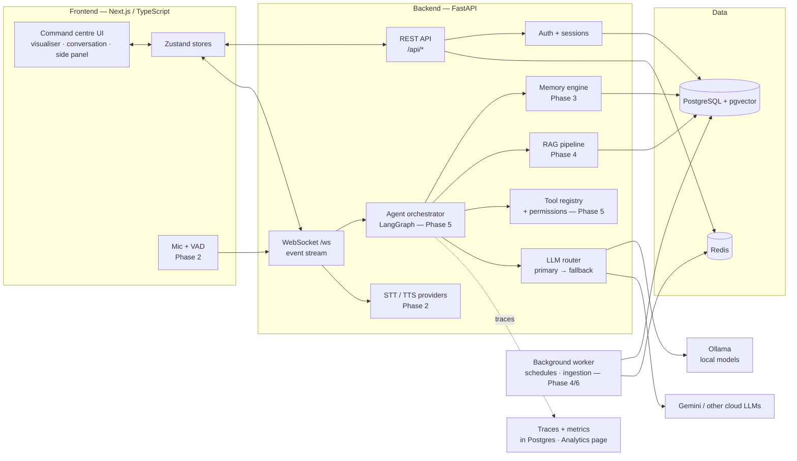
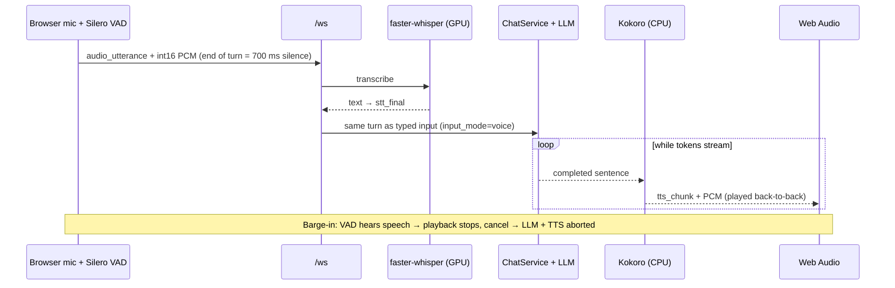

# LOKI — Architecture

LOKI is a voice-first, memory-backed, tool-using personal assistant. This document is the
target architecture for all phases; each section says which phase delivers it.

## 1. System overview

### Request path (text, Phase 1)

1. Browser opens `ws://<api>/ws` (session cookie authenticates it, `Origin` is checked).
2. Client sends `{"type":"user_message", ...}`.
3. Server stores the user message, builds context (system prompt + recent turns within a budget),
   and streams tokens from the LLM router as `token` events.
4. On completion the assistant message is stored with provider, model, token counts and latency.
5. Client can send `{"type":"cancel"}` at any time; the server stops generation and stores
   the partial reply marked as interrupted. This is the same mechanism voice barge-in will use.

### Request path (voice, Phase 2 ✅)

Only finished utterances leave the browser; silence and background audio are never sent. The
end-of-turn decision is made by the client VAD (`redemptionMs`). Whisper isn't a streaming model,
so there are no partial transcripts. With a 0.2–0.5 s transcription time this isn't needed for
turn-taking. LiveKit/WebRTC transport can replace the WebSocket later for remote/mobile use without
changing the providers.

## 2. The eight subsystems

| # | Subsystem | Key design | Phase |
|---|-----------|-----------|-------|
| A | Voice engine | `STTProvider` / `TTSProvider` interfaces; Deepgram, faster-whisper (local, CUDA), ElevenLabs, Piper/Kokoro (local) | 2 |
| B | Memory engine | 4 kinds (profile, episodic, semantic, working). LLM extraction → classifier decides keep/discard → secret filter → embed → dedupe (cosine > 0.92 merges) → store with validity window. Retrieval = vector + recency + importance score | 3 |
| C | Agent engine | LangGraph state graph: `understand → retrieve → plan → (tool loop: select → validate → execute → verify) → respond → memorise`. Specialist "modes" are subgraphs, not separate LLMs | 5 |
| D | Tools | Registry of typed tools (Pydantic input schema, timeout, permission level, audit log). Levels: `read`, `reversible`, `confirm`. Shell = allowlist + explicit approval | 5 |
| E | RAG | ingest → extract → clean → structure-aware chunking → metadata → embed → pgvector + Postgres FTS (hybrid, RRF) → rerank (cross-encoder) → cited context | 4 |
| F | Personalisation | Validated preferences JSON (style, voice, proactive, quiet hours) + learned profile memories; style and a `<project>` briefing (detected by name or time reference) are injected into the system prompt | 6 ✅ |
| G | Proactive | In-process `ProactiveScheduler`: fixed-interval jobs (reminders, deadlines, event heads-up, daily briefing, conversation summaries, watched folders, quiet-hours release), all gated by user preferences and a master switch; only summaries call the LLM | 6 ✅ |
| H | Evaluation | Built-in tracing (per-turn spans via a context variable, buffered writer, no content) + metric events; Analytics dashboard; offline suites for retrieval/answers, agent and voice (`backend/eval`, see EVALUATION.md) | 7 ✅ |

## 3. Trust boundaries (prompt-injection defence)

- System instructions live only in the system message. Retrieved memories, document chunks,
  web pages and tool outputs are inserted inside clearly delimited `<context source="...">`
  blocks with an instruction that their contents are data.
- The agent can only *request* tool calls; the tool executor enforces permission level
  regardless of what the model says. `confirm`-level tools pause the graph and wait for the user.
- Memory extraction runs a secret detector (regex + entropy) before anything is stored.
- Every user-owned row carries `user_id`; every query filters by it.

## 4. Model and provider management

- `LLMProvider` interface: `stream_chat()`, `health()`; implementations: Ollama, Gemini.
- `LLMRouter`: primary → fallback. Falls back only if the primary fails *before the first token*
  (mid-stream failure is surfaced as an error rather than silently switching voices/models).
- Timeouts (connect + per-chunk idle), retries with backoff on connection errors only.
- Usage (prompt/completion tokens, latency, provider, model) recorded per assistant message.
- Keys come from environment / `.env` only; never stored in the DB or sent to the frontend.

## 5. Known limitations on the current machine

| Limitation | Impact | Plan |
|---|---|---|
| Docker Desktop (installed for Phase 3) | Postgres 16 + pgvector run in Docker (`docker compose up -d postgres`). SQLite still works for quick dev/tests (vector search runs in Python there). | Use `127.0.0.1`, not `localhost`, in `DATABASE_URL` (IPv6 fallback made connections about 5× slower). Redis is defined but not used yet. |
| Ollama defaults to the AMD iGPU (it reports more memory) | 3.6× slower generation | Solved: `scripts/start-ollama.ps1` runs LOKI's Ollama on port 11435 with the AMD GPU hidden. |
| Local model is `qwen3:4b-instruct` (4B) | Fast (about 0.2 s to first token) and tool-capable, but weaker at long multi-step reasoning. | RTX 5060 (8 GB) can run 7–8B models (`qwen3:8b`, 5.2 GB) next to Whisper; configure Gemini as a fallback for heavy agentic work. |
| Celery has no official Windows support | Background work (document ingestion, the reminder scheduler) runs as in-process async tasks; both survive restarts via database state. Phase 6 jobs also run in-process (`ProactiveScheduler`); a separate worker only if they outgrow one machine. |
| Windows has no IANA timezone database | `zoneinfo` fails without it. | `tzdata` package (Phase 5). |
| Ollama's default 4,096-token context | Long prompts (memory + documents + tools) were silently truncated. | `OLLAMA_NUM_CTX=12288` on every request and on warm-up. |
| No cloud API keys set | Only Ollama works today. | Add `GEMINI_API_KEY` (LLM), `DEEPGRAM_API_KEY`, `ELEVENLABS_API_KEY` (voice) when ready; all optional. |
| Proactive notifications | Reach open LOKI tabs and desktop notifications only; quiet hours hold them server-side. | Web Push (VAPID) later. |

## 6. External services and credentials

| Service | Needed for | Required? | Env var |
|---|---|---|---|
| Ollama (local) | Default LLM, local embeddings | Yes (or a cloud LLM) | `OLLAMA_BASE_URL` |
| Google Gemini | Cloud LLM / fallback | Optional | `GEMINI_API_KEY` |
| Deepgram | Low-latency streaming STT | Optional (local Whisper alternative) | `DEEPGRAM_API_KEY` |
| ElevenLabs | High-quality TTS | Optional (local Piper/Kokoro alternative) | `ELEVENLABS_API_KEY` |
| Web search (Tavily / Brave / SearXNG) | Research agent | Phase 5 | `SEARCH_API_KEY` |
| Weather (Open-Meteo) | Weather tool | No key needed | — |
| Langfuse | Observability | Not used: tracing is built in (self-hosted Langfuse needs ClickHouse/Redis/MinIO; the cloud would receive conversation content) | — |
